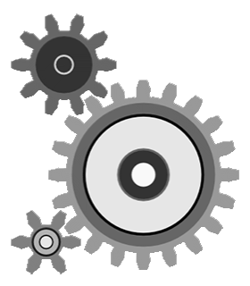
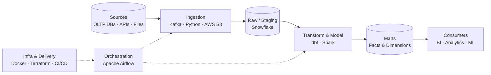

<!-- ============================== BANNER ============================== -->

  

  

<!-- ============================== PORTFOLIO ============================== -->

  

<!-- ============================== CONNECT ============================== -->

  
  
  
  

  

---

## 👨‍💻 About Me

I'm a **Data Engineer** who builds the plumbing that turns raw, scattered data into **trusted, analytics-ready datasets**. I work across the full data lifecycle — ingestion, transformation, modeling, orchestration, and deployment — with a strong focus on **reliability, data quality, and automation**.

- 🔭 Building **batch & streaming pipelines** and **dimensional data models** as a Data Engineer
- 🏗️ Designing ELT workflows with **Airflow + dbt + Snowflake**
- 🌊 Working with event streams using **Kafka**
- ⚙️ Shipping data infrastructure the engineering way — **Docker, Terraform, CI/CD**
- 🎓 **B.Tech, Electronics & Communication Engineering** — NIT Allahabad (MNNIT), 2024
- 💬 Happy to talk **Data Modeling, Data Warehousing, Streaming, DevOps for Data**

 

---

##  How I Build Data Platforms

---

## 🛠️ Tech Stack

| Area | Tools |
|---|---|
| **Languages** |    |
| **Orchestration & Transformation** |   |
| **Streaming & Big Data Processing** |      |
| **Data Warehouses & Databases** |       |
| **Cloud, DevOps & CI/CD** |       |
| **Also worked with — Backend & Web** |         |

---

## 🧩 Core Competencies

| Area | What I do |
|------|-----------|
| **Data Ingestion** | Build batch and streaming ingestion from databases, APIs, files, and Kafka topics into the lake/warehouse |
| **Transformation & Modeling** | Layered dbt models (staging → marts), star-schema facts & dimensions, reusable macros |
| **Orchestration** | Airflow DAGs with dependencies, retries, backfills, and alerting |
| **Data Warehousing** | Snowflake, Aurora & PostgreSQL — schema design, query tuning, stored procedures |
| **Distributed Processing** | Large-scale transformations with Spark / PySpark |
| **DataOps** | Containerized workloads with Docker, infra-as-code with Terraform, automated testing & deploys via CI/CD |

---

## 🚀 Featured Projects

| Project | Description | Stack |
|---------|-------------|-------|
| [**Zomato Data Modeling**](https://github.com/anupeshverma/Zomato_AI_Data_Analysis) | dbt project modeling food-delivery data: source definitions, staging models for orders, menus, users, restaurants and reviews, and a dimensional mart layer (`dim_customer`, `dim_restaurants`, `dim_food`, `dim_date`) with custom schema macros | `dbt` `SQL` `Data Modeling` |
| [**HandyScripts**](https://github.com/anupeshverma/HandyScripts) | Practical data-engineering utilities: AWS S3 → Snowflake ETL, S3 file management, CSV → DB loaders, Postgres → Pandas extraction, file-format conversion, and GenAI/LLM experiments | `Python` `AWS S3` `Snowflake` `PostgreSQL` |
| [**HandyQueries**](https://github.com/anupeshverma/HandyQueries) | Reusable PostgreSQL functions and stored procedures for automating repetitive query workloads | `PL/pgSQL` `PostgreSQL` |

  
  

---

## 🏆 Achievements

- 🥇 **14th Global Rank — Hacksquad:** contributed to open-source projects in a team event
- 🏅 **Platinum Winner — DevElevate (Showwcase):** technical blog writing competition
- ☁️ **Google Cloud Skills Boost:** earned multiple GCP skill badges — [view profile](https://www.cloudskillsboost.google/public_profiles/a2de6082-dfa4-4530-8003-749edfd645eb)

##  Badges Earned

  

  

---

## 📊 GitHub Stats

  
  

  

  

##  GitHub Trophies

  

---

  <i>"Without data, you're just another person with an opinion." — W. Edwards Deming</i>

  

